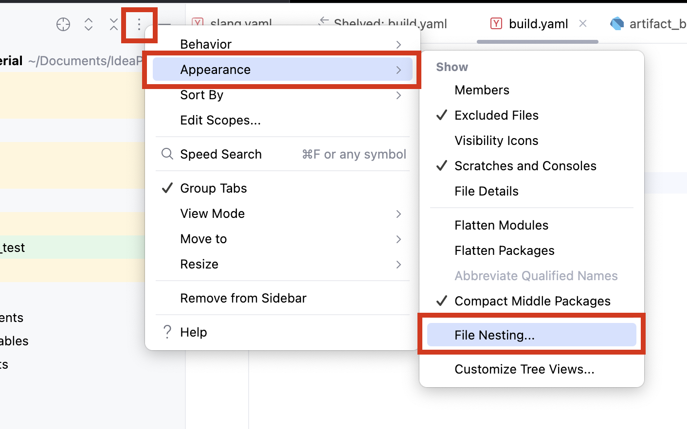
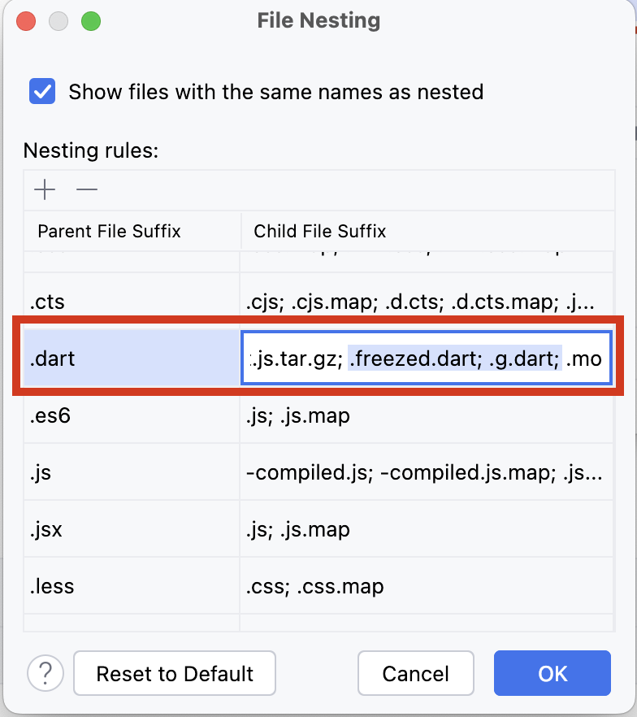

# Development

## Requirements

- [FVM](https://fvm.app) (the Flutter version is pinned in `.fvmrc`)

## Build & Run

Use FVM to run the app.

```shell
$ fvm flutter run
```

For commands, architecture, and coding conventions, see [CLAUDE.md](./CLAUDE.md).

## Scripts

Common commands such as code generation are defined in the `scripts` section of `package.json`.
Run them with npm or any other Node.js package manager.

```shell
$ npm run br
$ npm run slang:watch
```

## Firebase

Debug and profile builds run without any Firebase setup.
Without the config files, Crashlytics is disabled and Remote Config falls back to the in-app defaults, which keep the **HoYoLAB link turned off**.

To try the HoYoLAB link or Remote Config, set up **your own** Firebase project:

1. Create a project in the [Firebase Console](https://console.firebase.google.com/) and enable **Crashlytics** and **Remote Config**.
2. Register an Android app and an iOS app with the package name / bundle ID `net.chikach.genshinmaterial`.
3. In Remote Config, set `hoyolab_link_enabled` to `true`.
4. Download the config files from the project settings and place them as follows:
    - `google-services.json` → `android/app/`
    - `GoogleService-Info.plist` → `ios/Runner/`

Release builds fail without these files.

## About Generated Files

In this project, files generated by Freezed, Riverpod, etc. are included in the same directory.
To improve the readability of the file list, configure **File Nesting**.

### IntelliJ IDEA

Add `.freezed.dart` and `.g.dart` to `.dart` parent file suffix.



